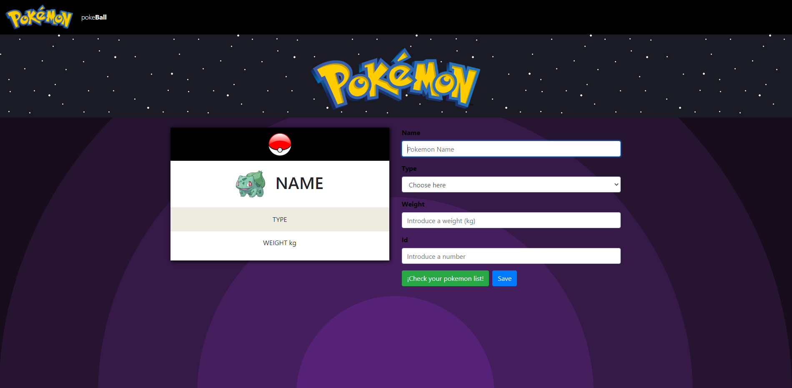
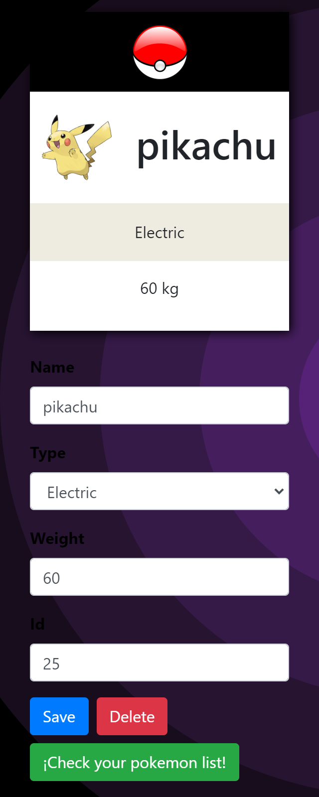

# Página web para crear tu propio pokemon

Integrada con la api de pokeapi.co y tecnologias como React.JS

##### Diseño responsive para movil y escritorio

[Ver la página en linea](https://your-own-pokemon.pontzi.vercel.app/)

## ¿Cómo funciona?

- `npm install` para instalar las dependencias.
- `npm start` para abrir entorno.

## Licencia

MIT
